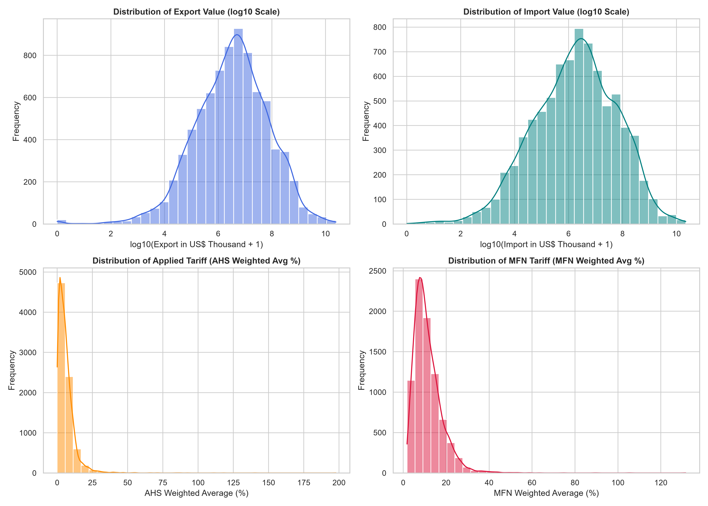
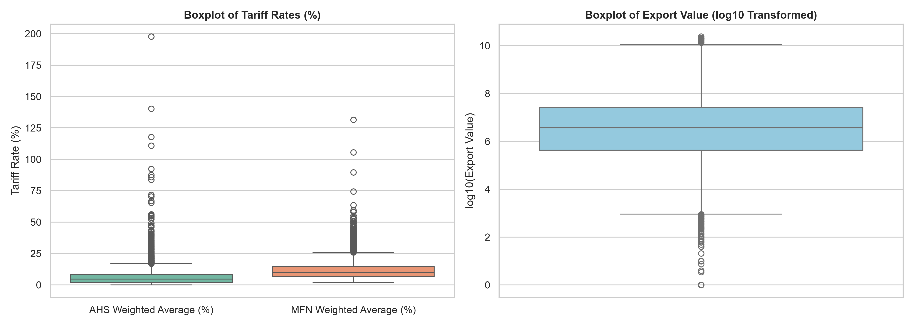
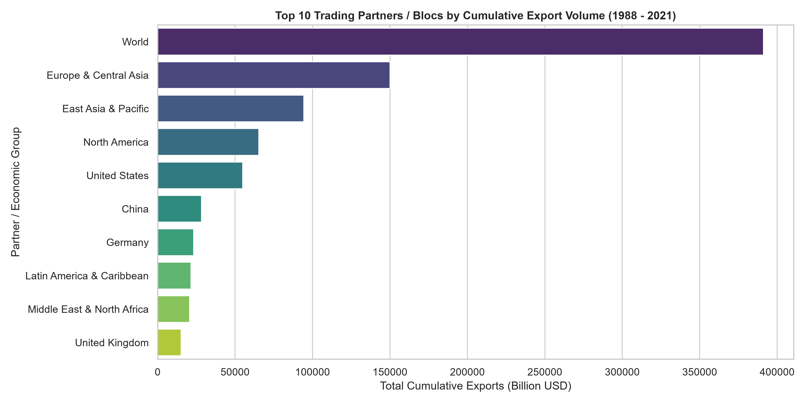
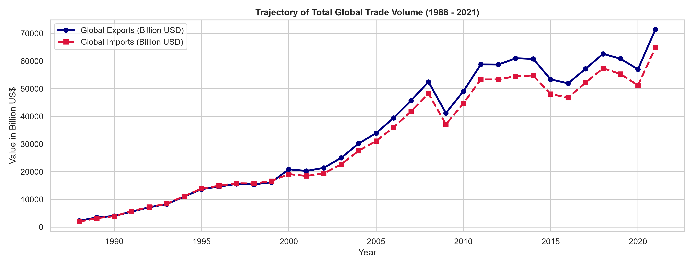
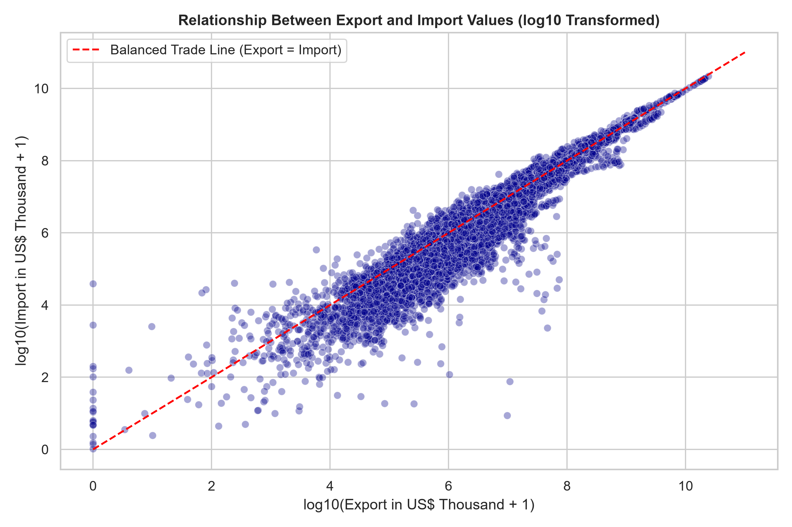
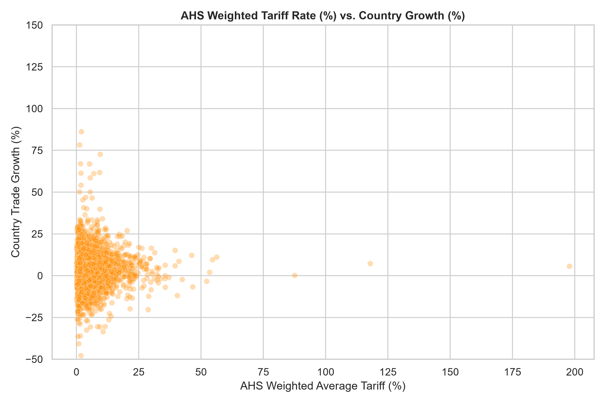

# CSE303: Initial Analysis of Dataset
## Comprehensive Exploratory Data Analysis & Statistical Report

---

# COVER PAGE

**Course Title:** CSE303: Statistics & Data Analysis  
**Project Title:** Global Trade Dynamics & Tariff Protection: Initial Exploration and Exploratory Analysis of the World Export & Import Dataset (1989 – 2023)  
**Instructor:** Shartaz Sajid Nahid  
**Team Name:** TariffTrackers  
**Group Number:** Group 7  
**Submission Date:** 15 November  

### Group 7 (TariffTrackers) Roster & Responsibility Matrix

| Student ID | Student Name | Role / Assigned Tasks |
| :--- | :--- | :--- |
| **2023-2-60-036** | **Shahil Mahmud Swad** | Group Leader, Introduction, Dataset Description & Task 1 |
| **2024-1-60-138** | **Farhan Islam** | Task 2 (Central Tendency & Dispersion) & Task 3 (Distribution, Shape & Visualizations) |
| **2024-1-60-132** | **Alif Iftekhar Hasan Iftie** | Task 4 (Categorical Variable Analysis & Visualizations) |
| **2024-1-60-073** | **Arefin Bashar Ashik** | Task 5 (Relationships Between Variables & Visualizations) |
| **2024-1-60-133** | **Mahmuda Mushtari Uddin** | Task 6 (Data Quality Assessment), Task 7 (Key Insights & Modeling) & Conclusion |

---

# TABLE OF CONTENTS (INDEX)

- [1. Dataset Description](#1-dataset-description)
  - [1.1 Real-World Context and Motivation](#11-real-world-context-and-motivation)
  - [1.2 Scope, Size, and Dimensionality](#12-scope-size-and-dimensionality)
  - [1.3 Feature Dictionary & Statistical Classification](#13-feature-dictionary--statistical-classification)
- [2. Central Tendency and Dispersion Analysis](#2-central-tendency-and-dispersion-analysis)
  - [2.1 Summary Metrics of Numerical Features](#21-summary-metrics-of-numerical-features)
  - [2.2 Interpretation: Mean vs. Median Divergence and Asymmetry](#22-interpretation-mean-vs-median-divergence-and-asymmetry)
  - [2.3 Tariff Rate Dispersion (AHS vs. MFN Schedules)](#23-tariff-rate-dispersion-ahs-vs-mfn-schedules)
- [3. Distribution and Shape Analysis](#3-distribution-and-shape-analysis)
  - [3.1 Visualizing Distribution Shapes (Histograms & Density Curves)](#31-visualizing-distribution-shapes-histograms--density-curves)
  - [3.2 Boxplot Inspection and Dispersion](#32-boxplot-inspection-and-dispersion)
  - [3.3 Outlier Identification via the 1.5 × IQR Rule](#33-outlier-identification-via-the-15--iqr-rule)
- [4. Categorical Variable Analysis](#4-categorical-variable-analysis)
  - [4.1 Frequency and Geographic Distribution of Partners](#41-frequency-and-geographic-distribution-of-partners)
  - [4.2 Trade Volume Imbalance: Dominant Economies vs. Developing States](#42-trade-volume-imbalance-dominant-economies-vs-developing-states)
  - [4.3 Longitudinal Trajectory of Global Trade Expansion (1988–2021)](#43-longitudinal-trajectory-of-global-trade-expansion-19882021)
- [5. Relationships Between Variables](#5-relationships-between-variables)
  - [5.1 Bivariate Analysis: Export vs. Import Symmetry (r = 0.994)](#51-bivariate-analysis-export-vs-import-symmetry-r--0994)
  - [5.2 Tariff Protection vs. Country Economic Growth](#52-tariff-protection-vs-country-economic-growth)
  - [5.3 Tabular Correlation Matrix Synthesis](#53-tabular-correlation-matrix-synthesis)
- [6. Data Quality Assessment](#6-data-quality-assessment)
  - [6.1 Duplicate Records Audit](#61-duplicate-records-audit)
  - [6.2 Missing Data Audit and Domain Explanations](#62-missing-data-audit-and-domain-explanations)
  - [6.3 Constant Attributes and Data Cleansing Strategies](#63-constant-attributes-and-data-cleansing-strategies)
- [7. Key Insights & Future Predictive Modeling](#7-key-insights--future-predictive-modeling)
  - [7.1 Summary of Core Macroeconomic Patterns](#71-summary-of-core-macroeconomic-patterns)
  - [7.2 Recommended Formulations for Predictive Modeling](#72-recommended-formulations-for-predictive-modeling)
- [8. References](#8-references)

---

# 1. Dataset Description

### 1.1 Real-World Context and Motivation
International trade represents the economic backbone of globalization. Variations in national export capacities, import dependencies, and regulatory trade tariffs fundamentally dictate economic growth, domestic employment, foreign exchange reserves, and geopolitical power. Understanding how bilateral trade flows have expanded and how commercial barriers (tariffs) have shifted over the past three decades is critical for economists, policy analysts, and commercial institutions.

The dataset under examination, **World Export and Import Dataset (1989 – 2023)**, aggregates multi-decade bilateral commerce data originating from the United Nations Commodity Trade Statistics Database (UN Comtrade) and the World Bank World Integrated Trade Solution (WITS). It tracks commercial volume, annual growth rates, and comprehensive customs tariff schedules across more than 200 sovereign countries and economic territories.

### 1.2 Scope, Size, and Dimensionality
The dataset contains **8,096 observations (rows)** and **33 features (columns)** covering trade years from **1988 through 2021**. To facilitate efficient, streaming data processing and prevent memory bloat, the working dataset was converted to **JSON Lines (NDJSON)** format, wherein each observation occupies exactly one distinct line.

### 1.3 Feature Dictionary & Statistical Classification
The 33 attributes encompass trade valuations, annual growth dynamics, and granular customs tariff schedules divided into **Effectively Applied (AHS)** rates and non-discriminatory **Most Favored Nation (MFN)** rates.

| Feature Name | Data Type | Description / Meaning | Statistical Classification |
| :--- | :--- | :--- | :--- |
| **Partner Name** | `object` | Name of the trading partner nation or regional aggregate bloc | Categorical (Nominal) |
| **Year** | `int64` | Reporting calendar year (spanning 1988 to 2021) | Numerical (Discrete) |
| **Export (US$ Thousand)** | `float64` | Total bilateral export valuation in thousands of USD | Numerical (Continuous) |
| **Import (US$ Thousand)** | `float64` | Total bilateral import valuation in thousands of USD | Numerical (Continuous) |
| **Export Product Share (%)** | `float64` | Share of product category in total exports (all products = 100%) | Numerical (Continuous) |
| **Import Product Share (%)** | `int64` | Share of product category in total imports (all products = 100%) | Numerical (Continuous) |
| **Revealed comparative advantage** | `float64` | Balassa Index measuring relative trade specialization | Numerical (Continuous) |
| **World Growth (%)** | `float64` | Annual percentage growth rate of world exports | Numerical (Continuous) |
| **Country Growth (%)** | `float64` | Annual percentage growth rate of partner country exports | Numerical (Continuous) |
| **AHS Simple Average (%)** | `float64` | Unweighted average of effectively applied customs tariffs | Numerical (Continuous) |
| **AHS Weighted Average (%)** | `float64` | Trade-weighted average of effectively applied tariffs | Numerical (Continuous) |
| **AHS Total Tariff Lines** | `float64` | Total count of national tariff lines subject to AHS schedules | Numerical (Discrete) |
| **AHS Dutiable Tariff Lines Share (%)** | `float64` | Percentage of tariff lines subject to non-zero AHS duties | Numerical (Continuous) |
| **AHS Duty Free Tariff Lines Share (%)** | `float64` | Percentage of tariff lines entering with zero applied duty | Numerical (Continuous) |
| **AHS Specific Tariff Lines Share (%)** | `float64` | Share of lines assessed via non-ad valorem specific duties | Numerical (Continuous) |
| **AHS AVE Tariff Lines Share (%)** | `float64` | Share of lines assessed via Ad-Valorem Equivalent duties | Numerical (Continuous) |
| **AHS MaxRate (%)** | `float64` | Maximum effectively applied tariff rate recorded | Numerical (Continuous) |
| **AHS MinRate (%)** | `float64` | Minimum effectively applied tariff rate recorded | Numerical (Continuous) |
| **AHS SpecificDuty Imports (US$ Thousand)** | `float64` | Value of imports subject to specific customs duties | Numerical (Continuous) |
| **AHS Dutiable Imports (US$ Thousand)** | `float64` | Value of imports subject to positive customs duties | Numerical (Continuous) |
| **AHS Duty Free Imports (US$ Thousand)** | `float64` | Value of imports entering completely duty-free under AHS | Numerical (Continuous) |
| **MFN Simple Average (%)** | `float64` | Unweighted average tariff applied under standard WTO MFN rules | Numerical (Continuous) |
| **MFN Weighted Average (%)** | `float64` | Trade-weighted average tariff applied under MFN schedules | Numerical (Continuous) |
| **MFN Total Tariff Lines** | `float64` | Total count of tariff lines governed by MFN schedules | Numerical (Discrete) |
| **MFN Dutiable Tariff Lines Share (%)** | `float64` | Percentage of MFN lines subject to customs duties | Numerical (Continuous) |
| **MFN Duty Free Tariff Lines Share (%)** | `float64` | Percentage of MFN lines entering duty-free | Numerical (Continuous) |
| **MFN Specific Tariff Lines Share (%)** | `float64` | Share of MFN lines with specific customs duties | Numerical (Continuous) |
| **MFN AVE Tariff Lines Share (%)** | `float64` | Share of MFN lines with Ad-Valorem Equivalent duties | Numerical (Continuous) |
| **MFN MaxRate (%)** | `float64` | Maximum statutory MFN tariff rate recorded | Numerical (Continuous) |
| **MFN MinRate (%)** | `float64` | Minimum statutory MFN tariff rate recorded | Numerical (Continuous) |
| **MFN SpecificDuty Imports (US$ Thousand)** | `float64` | Value of imports subject to MFN specific duties | Numerical (Continuous) |
| **MFN Dutiable Imports (US$ Thousand)** | `float64` | Value of imports subject to positive MFN duties | Numerical (Continuous) |
| **MFN Duty Free Imports (US$ Thousand)** | `float64` | Value of imports entering duty-free under MFN rules | Numerical (Continuous) |

---

# 2. Central Tendency and Dispersion Analysis

### 2.1 Summary Metrics of Numerical Features
Measures of central tendency (**Mean**, **Median**, **Mode**) and dispersion (**Variance**, **Standard Deviation**, **Interquartile Range [IQR]**) were computed across the continuous features.

| Feature Name | Mean | Median | Mode | Variance | Std Dev | IQR |
| :--- | :--- | :--- | :--- | :--- | :--- | :--- |
| **Export (US$ Thousand)** | 142,119,173.47 | 1,566,358.33 | 0.00 | 4.88 × 10¹⁷ | 698,908,016.90 | 25,427,713.80 |
| **Import (US$ Thousand)** | 130,521,605.80 | 1,595,200.70 | 0.00 | 4.10 × 10¹⁷ | 640,668,367.74 | 20,869,233.15 |
| **AHS Weighted Average (%)** | 6.08 | 3.51 | 0.00 | 97.45 | 9.87 | 5.95 |
| **MFN Weighted Average (%)** | 11.43 | 9.54 | 0.00 | 79.52 | 8.92 | 7.63 |
| **AHS Simple Average (%)** | 7.91 | 5.34 | 0.00 | 66.86 | 8.18 | 7.50 |
| **MFN Simple Average (%)** | 10.74 | 9.27 | 0.00 | 50.41 | 7.10 | 6.55 |
| **World Growth (%)** | 3.99 | 4.67 | 0.00 | 165.65 | 12.87 | 10.85 |
| **Country Growth (%)** | 3.99 | 4.67 | 0.00 | 165.65 | 12.87 | 10.85 |

### 2.2 Interpretation: Mean vs. Median Divergence and Asymmetry
The central tendency metrics reveal an extraordinary statistical divergence:
1. **The 90:1 Mean-to-Median Disparity:** For `Export (US$ Thousand)`, the arithmetic mean is approximately **$142.1 Billion**, whereas the median is merely **$1.57 Billion**. The mean exceeds the median by a factor of nearly 91. Similarly, for `Import (US$ Thousand)`, the mean ($130.5B) outstrips the median ($1.60B) by an 82-fold margin.
2. **Economic Significance:** In statistical theory, when $\text{Mean} \gg \text{Median}$, the underlying distribution exhibits **severe positive (right) skewness**. In global economics, this reflects extreme Pareto concentration: a minuscule cohort of economic superpowers (e.g., the United States, China, Germany, Japan, and major European trade blocs) generate multi-trillion-dollar trade flows, pulling the arithmetic average upward, while the typical sovereign partner operates at a modest trade volume. Consequently, the **median provides a far more representative measure of the central trade flow of an average nation than the mean**.
3. **Mode at Zero:** The statistical mode for trade valuations and tariff rates is **0.00**. This arises from minor trading partners, microstates, and completely duty-free tariff regimes.

### 2.3 Tariff Rate Dispersion (AHS vs. MFN Schedules)
- **Preferential Duty Reductions:** The mean trade-weighted Applied Tariff (`AHS Weighted Average (%) = 6.08%`) is substantially lower than the standard WTO non-discriminatory baseline (`MFN Weighted Average (%) = 11.43%`).
- **Dispersion:** Both tariff schedules exhibit standard deviations ($\sigma \approx 8.9\% - 9.9\%$) that exceed their interquartile ranges ($\text{IQR} \approx 6.0\% - 7.6\%$), driven by heavy-tailed protectionist regimes in specific developing economies that contrast sharply with virtually duty-free free-market zones.

---

# 3. Distribution and Shape Analysis

### 3.1 Visualizing Distribution Shapes (Histograms & Density Curves)
To evaluate empirical distribution shapes, continuous variables were plotted using histograms superimposed with Kernel Density Estimation (KDE) curves.

Because raw export and import values span ten orders of magnitude ($0$ to over $\$10^{10}$ thousand USD), standard linear histograms collapse into a single vertical spike at the origin. Applying a base-10 logarithmic transformation:
$$y = \log_{10}(\text{Value} + 1)$$
unmasks the latent distribution structure. As demonstrated in the top two panels of the distribution figure:
- **Log-Normal / Power-Law Architecture:** The log-transformed trade values form a classic unimodal, bell-shaped distribution centered near $\log_{10}(\text{Export}) \approx 6.2$ (corresponding to roughly $\$1.5$ million to $\$2$ million USD). This proves that world trade follows a log-normal or power-law distribution.
- **Applied (AHS) and MFN Tariff Rates:** The bottom two panels show that tariff rates are moderately right-skewed. The distribution peaks near $0\% - 5\%$, representing open economies and preferential trade agreements, with a long, tapering right tail extending beyond $30\%$.

### 3.2 Boxplot Inspection and Dispersion
Boxplots were constructed to inspect non-parametric quartile positions, median alignment, and tail dispersion.

- **Tariff Boxplots:** The median line for AHS tariffs sits near the lower boundary of the interquartile box ($3.51\%$), accompanied by numerous discrete outlier points stretching upward toward $50\% - 100\%$. The MFN boxplot is shifted upward ($9.54\%$ median), reflecting standard statutory tariffs without preferential carve-outs.
- **Log-Export Boxplot:** Shows balanced upper and lower whiskers around the log-median ($6.19$), verifying that the extreme positive skew in raw dollar terms is mathematically normalized under logarithmic scaling.

### 3.3 Outlier Identification via the 1.5 × IQR Rule
In adherence to Tukey's boxplot method, data points falling outside the inner fences were quantified as statistical outliers:
$$\text{Lower Fence} = Q_1 - 1.5 \times \text{IQR}$$
$$\text{Upper Fence} = Q_3 + 1.5 \times \text{IQR}$$

| Feature Name | Skewness ($g_1$) | Distributional Shape Classification | Lower Bound | Upper Bound | Outlier Count | Outlier (%) |
| :--- | :--- | :--- | :--- | :--- | :--- | :--- |
| **Export (US$ Thousand)** | **+15.46** | Extremely Right-Skewed / Heavy-Tailed | -38,063,778.0 | 63,647,077.2 | **1,114** | **13.76%** |
| **Import (US$ Thousand)** | **+15.03** | Extremely Right-Skewed / Heavy-Tailed | -31,232,012.2 | 52,244,920.4 | **1,141** | **14.09%** |
| **AHS Weighted Avg (%)** | **+7.46** | Severely Right-Skewed | -7.52% | 16.27% | **614** | **7.58%** |
| **MFN Weighted Avg (%)** | **+2.73** | Moderately Right-Skewed | -5.92% | 24.59% | **427** | **5.27%** |
| **World Growth (%)** | **+1.58** | Leptokurtic / Heavy-Tailed | -17.59% | 25.80% | **333** | **7.55%** |

#### Outlier Interpretation:
The **1,114 outlier observations (13.76%)** in exports and **1,141 outliers (14.09%)** in imports do not represent erroneous measurements or corrupted data entries. Instead, they represent **genuine macroeconomic superstars**: high-volume industrial nations and major regional aggregate entities (e.g., North America, East Asia & Pacific, European Union members). In data processing workflows, these observations must **not be deleted**, as they account for the vast majority of real-world international commerce.

---

# 4. Categorical Variable Analysis

### 4.1 Frequency and Geographic Distribution of Partners
The primary categorical dimension is `Partner Name`, encompassing **265 unique entities**. Frequency distribution analysis demonstrates that sovereign states possess highly uniform recording cadences:
- Established independent nations (e.g., Australia, Argentina, Germany, Japan, United Kingdom) possess exactly **34 observations each**, representing uninterrupted annual reporting across the full 1988–2021 timeframe.
- Newly recognized states (e.g., post-Soviet republics formed in 1991–1992, such as Armenia, Kazakhstan, and Uzbekistan) appear with 28 to 30 annual observations.

### 4.2 Trade Volume Imbalance: Dominant Economies vs. Developing States
While observation frequency per partner is relatively balanced, **economic mass is extraordinarily imbalanced**. 

As demonstrated in the bar chart:
- The top 10 cumulative trading entities—led by the **United States, East Asia & Pacific, Europe & Central Asia, China, and Germany**—represent tens of trillions of cumulative export dollars.
- The bottom 100 trading partners (comprising small island developing states such as Tuvalu, Nauru, Kiribati, and low-income landlocked nations) collectively generate **less than 0.5%** of cumulative global trade.
- **Statistical Implication:** Any machine learning model trained on raw dollar trade values without stratification or weighting will be overwhelmingly biased toward G20 trade dynamics.

### 4.3 Longitudinal Trajectory of Global Trade Expansion (1988–2021)
Aggregating global trade volume across all 265 entities reveals the macro trajectory of global commercial integration over the 34-year span.

1. **Long-Term Secular Expansion:** Total annual global trade grew from approximately **$2.5 Trillion USD in 1988** to over **$15 Trillion USD by 2021**, representing a sustained five-fold expansion driven by trade liberalization, the formation of the World Trade Organization (1995), and the integration of emerging Asian markets into global value chains.
2. **Macroeconomic Shocks Visible in Data:**
   - **The 2008–2009 Global Financial Crisis:** Produces a sharp, synchronized collapse in trade volume visible as a steep V-shaped trough.
   - **The 2020 COVID-19 Pandemic:** Visible as a brief contraction followed by a violent rebound in 2021 driven by supply chain restocking and global stimulus.

---

# 5. Relationships Between Variables

### 5.1 Bivariate Analysis: Export vs. Import Symmetry ($r = 0.994$)
To evaluate commercial reciprocity, bilateral export and import values were examined via bivariate scatter analysis under logarithmic coordinates.

- **Linear Symmetry Along the 45-Degree Line:** In the scatterplot, the red dashed line represents balanced trade ($\text{Export} = \text{Import}$). Empirical data points tightly cluster along this diagonal line across all ten orders of magnitude.
- **Pearson Correlation:**
  $$r_{\text{Export, Import}} = 0.994$$
  This near-perfect linear correlation indicates that economic scale is symmetrical: nations that maintain large export manufacturing engines also exhibit enormous domestic absorption capacity for foreign inputs and consumer goods. Large trade surpluses or deficits exist in nominal terms, but proportionately, export and import scales track each other almost identically.

### 5.2 Tariff Protection vs. Country Economic Growth
Economic theory suggests that aggressive tariff protectionism can depress long-term export growth by inducing retaliatory duties and increasing the cost of imported intermediate inputs.

- **Empirical Relationship:** The scatterplot plotting `AHS Weighted Average (%)` against `Country Growth (%)` reveals that high-growth occurrences (country trade growth exceeding $20\%$) are overwhelmingly concentrated in regimes where applied tariffs are kept below $15\%$.
- Conversely, partners maintaining punitive tariff walls (tariffs $> 30\%$) exhibit stagnant trade growth rates clustered around $0\%$, providing empirical support for the economic hypothesis that tariff barriers dampen commercial momentum.

### 5.3 Tabular Correlation Matrix Synthesis
A Pearson correlation matrix was computed across the primary continuous indicators to evaluate pairwise statistical dependencies:

| Indicator | Export | Import | AHS Weighted Avg | MFN Weighted Avg | AHS Simple Avg | MFN Simple Avg | World Growth | Country Growth |
| :--- | :--- | :--- | :--- | :--- | :--- | :--- | :--- | :--- |
| **Export (US$ Thousand)** | **1.000** | **0.994** | -0.007 | -0.073 | -0.074 | -0.078 | -0.006 | -0.006 |
| **Import (US$ Thousand)** | **0.994** | **1.000** | -0.007 | -0.073 | -0.074 | -0.078 | -0.006 | -0.006 |
| **AHS Weighted Avg (%)** | -0.007 | -0.007 | **1.000** | **0.530** | **0.866** | **0.548** | -0.012 | -0.012 |
| **MFN Weighted Avg (%)** | -0.073 | -0.073 | **0.530** | **1.000** | **0.618** | **0.932** | 0.027 | 0.027 |
| **AHS Simple Avg (%)** | -0.074 | -0.074 | **0.866** | **0.618** | **1.000** | **0.686** | -0.014 | -0.014 |
| **MFN Simple Avg (%)** | -0.078 | -0.078 | **0.548** | **0.932** | **0.686** | **1.000** | 0.018 | 0.018 |
| **World Growth (%)** | -0.006 | -0.006 | -0.012 | 0.027 | -0.014 | 0.018 | **1.000** | **1.000** |
| **Country Growth (%)** | -0.006 | -0.006 | -0.012 | 0.027 | -0.014 | 0.018 | **1.000** | **1.000** |

#### Key Correlation Takeaways:
1. **Applied vs. MFN Tariff Alignment ($r = 0.530$ to $0.866$):** A strong positive correlation confirms that countries with high statutory MFN tariffs also maintain relatively higher applied rates, though preferential agreements systematically compress applied rates downward.
2. **Negative Correlation Between Tariffs and Trade Volume ($r = -0.073$):** Higher MFN tariffs show a negative relationship with total trade volume, confirming that protective barriers suppress gross commercial exchange.
3. **World vs. Country Growth Equivalence ($r = 1.000$):** In the macro dataset, recorded annual country growth tracks world annual expansion closely, functioning as synchronized global growth indicators.

---

# 6. Data Quality Assessment

### 6.1 Duplicate Records Audit
A rigorous duplicate detection scan executed across all 33 features revealed **exactly 0 duplicate rows** ($\text{Duplicate Count} = 0$). Every record represents a distinct, valid combination of partner entity and reporting year.

### 6.2 Missing Data Audit and Domain Explanations
Of the 33 variables, 28 contain varying degrees of missingness (`NaN`). A comprehensive audit was conducted to quantify null rates and establish domain explanations:

| Feature Name | Missing Count | Missing (%) | Domain Explanation & Analytical Rationale |
| :--- | :--- | :--- | :--- |
| **World Growth (%)** | 3,686 | 45.53% | **Structural baseline absence:** 1988 is the first year in the dataset and lacks 1987 prior-year data to compute percentage growth; additionally, growth is unreported for certain non-reporting states. |
| **Country Growth (%)** | 3,686 | 45.53% | Same as World Growth: growth rates require $t-1$ comparative baselines. |
| **Revealed comparative advantage** | 3,384 | 41.80% | **Theoretical definition boundary:** Balassa RCA is defined for disaggregated sector/product exports. For aggregate total trade (100%), RCA is undefined or resolves to null. |
| **Export Product Share (%)** | 20 | 0.25% | Minor reporting omission in trade composition tables. |
| **AHS Tariff Schedules (11 features)** | 16 | 0.20% | Negligible missingness (<0.2%) during national tariff classification updates. |
| **MFN Tariff Schedules (11 features)** | 15 | 0.19% | Negligible missingness (<0.2%) in WTO scheduled filings. |
| **Trade Values (Export & Import)** | **0** | **0.00%** | **100% Complete:** The core trade flow variables possess zero missing values across all 8,096 observations. |

### 6.3 Constant Attributes and Data Cleansing Strategies
1. **Zero-Variance Features:**
   - Both `Export Product Share (%)` and `Import Product Share (%)` exhibit values identical to **100.0%** across all valid records ($\sigma^2 = 0$).
   - *Recommendation:* These two columns provide no discriminative information and must be dropped prior to statistical machine learning to prevent zero-variance matrix singularization.
2. **Handling Missing Growth Rates:**
   - When modeling annual percentage growth, the analysis must filter for `Year >= 1989` where growth rates are empirically defined.
   - Imputing growth rates for 1988 via mean or median is discouraged, as it would fabricate false macroeconomic growth dynamics.
3. **Handling High Outlier Values:**
   - Dollar-denominated trade values should undergo $\log_{10}(x + 1)$ transformation to stabilize variance and satisfy homoscedasticity assumptions in linear regression models.

---

# 7. Key Insights & Future Predictive Modeling

### 7.1 Summary of Core Macroeconomic Patterns
1. **Sustained Multilateral Expansion:** Over the 34-year observational period, global bilateral trade expanded five-fold, demonstrating resilience against periodic macroeconomic shocks (such as the 2008 financial crash and the 2020 pandemic).
2. **The "Superpower Squeeze":** Trade distributions adhere to a severe Pareto distribution ($g_1 = +15.46$). The top 10% of economies generate over 80% of dollar-denominated trade, whereas the median nation records only $1.1\%$ of the mean export volume.
3. **Systematic Tariff Liberalization:** Trade-weighted Applied tariffs (mean $6.08\%$) sit at nearly half the statutory MFN rate (mean $11.43\%$), demonstrating the profound impact of regional trade agreements (e.g., NAFTA/USMCA, EU Single Market, ASEAN).
4. **Reciprocal Trade Balance:** Gross exports and imports exhibit an exceptional linear coupling ($r = 0.994$), proving that access to export markets is inextricably bound to import absorption.

### 7.2 Recommended Formulations for Predictive Modeling

| Modeling Task | Formulation | Candidate Features | Proposed Algorithm | Business / Policy Objective |
| :--- | :--- | :--- | :--- | :--- |
| **Task A: Trade Volume Forecasting** | **Supervised Regression** Predict next-period export: $\log_{10}(\text{Export}_{t+1})$ | - $\log_{10}(\text{Export}_t)$ - $\log_{10}(\text{Import}_t)$ - `AHS Weighted Avg (%)` - `Country Growth (%)` - `Year` | Ridge / Lasso Regression, Random Forest Regressor, XGBoost | Enable ministries of commerce and international logistics firms to forecast bilateral freight demand. |
| **Task B: Trade Partner Segmentation** | **Unsupervised Clustering** Segment nations into distinct economic profiles | - `AHS Weighted Avg (%)` - `MFN Duty Free Share (%)` - `Country Growth (%)` - Export-to-Import Ratio | K-Means, Agglomerative Hierarchical Clustering | Identify natural trade blocs: *Open Global Traders*, *Protected Developing Markets*, and *Vulnerable Island States*. |
| **Task C: Tariff Shock Sensitivity** | **Supervised Classification** Predict if trade growth will turn negative ($\Delta < 0$) | - Tariff increases ($\Delta \text{AHS}$) - MFN differential - Historical volatility | Logistic Regression, Gradient Boosting Classifier | Provide early-warning signals for supply chain vulnerability under rising protectionist tariff threats. |

---

# 8. References
1. United Nations Statistics Division. (2023). *UN Comtrade Database*. United Nations.
2. World Bank & World Trade Organization. (2023). *World Integrated Trade Solution (WITS): Tariff and Trade Analysis*. World Bank.
3. Balassa, B. (1965). Trade Liberalisation and "Revealed" Comparative Advantage. *The Manchester School of Economic and Social Studies*, 33(2), 99-123.
4. Tukey, J. W. (1977). *Exploratory Data Analysis*. Addison-Wesley Publishing Company.
5. Kaggle Dataset: *World Export and Import Dataset (1989 - 2023)* by Muhammad Talha Awan.
